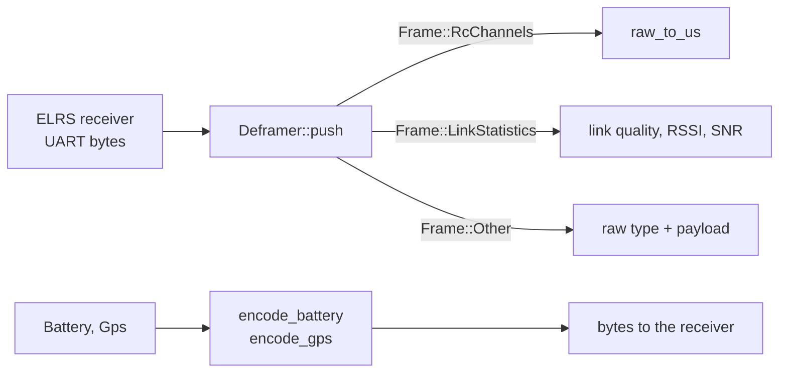

# crsf-codec

CRSF codec for a flight controller that listens to an ExpressLRS receiver on a UART. `no_std`, no dependencies (optional `defmt`
1.x behind the feature `defmt`), no I/O: bytes in, validated frames out. It reads RC channels and link statistics, passes every
other frame type through as raw bytes, and writes two frames, battery sensor and GPS. No time, allocation, statics or `unsafe`;
integer arithmetic only; it never panics on any input. It works on any target and any byte source.



## Quick start

`push` takes bytes in any chunking and calls `on_frame` once per accepted frame, in stream order.

```rust
use crsf_codec::{Deframer, Frame, raw_to_us};

// Two stray bytes, then an RC frame with channel 1 = 172, channel 2 = 992, channel 3 = 1811.
let stream: [u8; 28] = [
    0x00, 0x7F, 0xC8, 0x18, 0x16, 0xAC, 0x00, 0xDF, 0xC4, 0xC1, 0x07, 0x3E, 0xF0, 0x81, 0x0F,
    0x7C, 0xE0, 0x03, 0x1F, 0xF8, 0xC0, 0x07, 0x3E, 0xF0, 0x81, 0x0F, 0x7C, 0xB5,
];

let mut deframer = Deframer::new();
let mut sticks_us = None;
for chunk in stream.chunks(5) {
    deframer.push(chunk, |frame| {
        if let Frame::RcChannels(rc) = frame {
            sticks_us = Some(rc.raw.map(raw_to_us));
        }
    });
}
let sticks_us = sticks_us.unwrap();
assert_eq!(sticks_us[..3], [988, 1500, 2012]);
assert_eq!(deframer.stats().frames, 1);
assert_eq!(deframer.stats().garbage_bytes, 2);
```

## Docs

| Page | In one line |
|---|---|
| [frames](docs/frames.md) | Frame format, the deframer's resync rules, RC and link-statistics decoding, counters |
| [telemetry](docs/telemetry.md) | `encode_battery` and `encode_gps`: layouts, units, errors |
| [testing](docs/testing.md) | Host tests, and what the crate deliberately leaves out |

```text
src/  lib.rs  deframer.rs  decode.rs  battery.rs  gps.rs  crc.rs  tests.rs
```

## Used by

[rc-port](https://github.com/Lmx154/rc-port), which owns the UART and the policy around it; through it the MARV-FC firmware.

## Status

- Version 0.1.0, `publish = false`; the API may still change.
- Host tests: property, exhaustive and differential tests (see [testing](docs/testing.md)).
- On the MARV V2 Rev 1 board, through `rc-port`, it decoded a real ExpressLRS 4.0.1 receiver at 420000 baud: about 246 RC frames and
  10 link-statistics frames per second for several minutes with no CRC errors in CRSF mode. Its battery frame was shown by the
  handset as sent (12.3 V, 0.0 A, 0 mAh, 50 %).
- Frames captured from the receiver are not yet test vectors.

## MARV project

| Repository | Role |
|---|---|
| [MARV-FC](https://github.com/Lmx154/MARV-FC) | Flight-controller firmware for the MARV V2 board (RP2350B) |
| [MARV-GCS](https://github.com/Lmx154/MARV-GCS) | Ground station (`marv-gcs`) and command line (`marv-cli`) |
| [MARV-sim](https://github.com/Lmx154/MARV-sim) | Simulator that runs the firmware's flight code |
| Sensors | [icm45686](https://github.com/Lmx154/icm45686-rs) · [lsm6dsk320x](https://github.com/Lmx154/lsm6dsk320x-rs) · [bmp581](https://github.com/Lmx154/bmp581-rs) · [bmm350](https://github.com/Lmx154/bmm350-rs) · [sam-m10q](https://github.com/Lmx154/sam-m10q) · [adc-battery](https://github.com/Lmx154/adc-battery) |
| Board I/O | [pio-sdmmc](https://github.com/Lmx154/pio-sdmmc-rs) · [qmi-psram](https://github.com/Lmx154/qmi-psram-rs) · [ws2812c](https://github.com/Lmx154/ws2812c-rs) · [usb-cdc](https://github.com/Lmx154/usb-cdc) · [pio-uart](https://github.com/Lmx154/pio-uart) |
| Motors and links | [dshot](https://github.com/Lmx154/dshot-rs) · [esc-passthrough](https://github.com/Lmx154/esc-passthrough) · [rc-port](https://github.com/Lmx154/rc-port) · **crsf-codec** · [mavlink-device](https://github.com/Lmx154/mavlink-device) · [marv-dialect](https://github.com/Lmx154/marv-dialect) |
| Other drivers | [lc76g](https://github.com/Lmx154/lc76g-rs) (Quectel LC76G GNSS) |

## Licence

MIT, see `LICENSE`.
