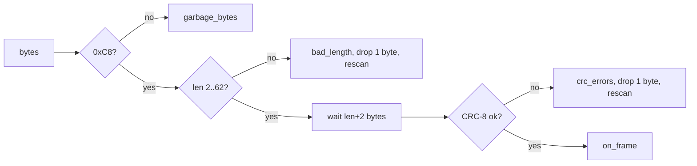

# Receiving: frames and the deframer

Part of [crsf-codec](../README.md)

`Deframer` turns an arbitrary byte stream into validated `Frame`s. It rescans after any error so one stray byte never costs a real
frame (apart from the odd case below), and it counts every byte it does not deliver.



## Frame format

`[address][len][type][payload...][crc8]`

| Field | Rule |
|---|---|
| Address | 0xC8 (the flight controller); the only address accepted and written |
| `len` | Counts type, payload and CRC; a frame is `len + 2` bytes, at most 64 |
| CRC | CRC-8, polynomial 0xD5, initial 0, no reflection, no final xor, over type and payload |

On a bad length or CRC the deframer drops one byte and rescans from the next, so a stray 0xC8 in garbage does not swallow a real
frame behind it. A stray 0xC8 with a plausible `len` is waited for to its end (at most 64 bytes) before it is rejected, so a real
frame behind it comes out only when that many bytes have arrived; with probability 1/256 the false candidate passes the CRC and the
real frame is lost.

## Decoded types

| Type | Payload | Decoded as |
|---|---|---|
| 0x16 RC channels | exactly 22 bytes | `RcChannels { raw: [u16; 16] }`: 16 raw 11-bit values, channel 1 in the lowest bits of the first byte, little-endian bit packing |
| 0x14 link statistics | exactly 10 bytes | `LinkStatistics`, all raw as received: uplink RSSI ant 1, ant 2, link quality, SNR (`i8`), active antenna, RF mode, TX power index, downlink RSSI, link quality, SNR (`i8`) |
| anything else | any | `Frame::Other { frame_type, payload }`, counted in `other_frames`; so is a 0x16 or 0x14 frame of another length |

`Frame` is `#[non_exhaustive]` and borrows the deframer's buffer: valid inside the `on_frame` call only. The result is the same
however the stream is split, down to one byte per `push`.

`raw_to_us(v)` is `(v * 5 + 4) / 8 + 880` in wider arithmetic: 172 gives 988, 992 gives 1500, 1811 gives 2012. It is not clamped and
is defined for every `u16`. In the switch modes that do not send 16 channels, channels 15 and 16 carry link quality and RSSI; the
crate passes them as received.

## API

```text
Deframer::new() -> Self                     (const)
Deframer::push(&mut self, bytes: &[u8], on_frame: impl FnMut(Frame<'_>))
Deframer::stats(&self) -> Stats             (const)
Deframer::clear(&mut self)                  drops buffered bytes, counted as garbage (e.g. after a baud rate change)
raw_to_us(v: u16) -> u16                    (const)
```

## Counters

`Deframer::stats()` returns `Stats`, all `u32` and saturating.

| Counter | Counts |
|---|---|
| `garbage_bytes` | Bytes discarded without being part of an accepted frame (before an address byte; the first byte of each rejected candidate) |
| `bad_length` | Candidates whose length byte is outside 2 to 62 |
| `crc_errors` | Candidates whose CRC did not match |
| `frames` | Accepted frames of every type |
| `other_frames` | Accepted frames that came out as `Frame::Other` |

Every byte pushed is exactly one of: buffered, in an accepted frame, or counted as garbage.

## Code

`src/deframer.rs`, `src/decode.rs`, `src/crc.rs` (the CRC function is not public).

## Related

[telemetry](telemetry.md) for the frames written back; [testing](testing.md); [rc-port](https://github.com/Lmx154/rc-port) is the
UART task that feeds the deframer.
